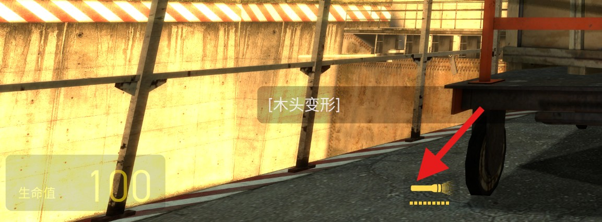

# HL2FlashlightFix

修复中文/日文/韩文等 DBCS 代码页下《半条命 2》HUD 手电筒图标显示成**大向下箭头**的问题。

Fixed an issue where the Half-Life 2 HUD flashlight icon displayed as a **large down arrow** at the bottom of the DBCS code page in Chinese, Japanese, Korean, etc. 

感谢如今 AI 的强大！

由 Deepseek 分析。



## 解决方法

令人意外的简单！

**注意：修改后如果使用了“验证游戏完整性”则一切修改会复原！**

### 1. 修改 `fontinfo.kv` 文件

找到 `Half-Life 2\platform\resource\fontinfo.kv`

使用记事本或者其它文本编辑器打开 `fontinfo.kv` 文件，在尾部添加：

```
FontInfo
{
    // Force GorDIN to always use freetype2.
    "GorDIN" "freetype2"
    "GorDIN-Black" "freetype2"
    "GorDIN-Bold" "freetype2"
    "GorDIN-Light" "freetype2"
    "GorDIN-Regular" "freetype2"
    "GorDIN-Semibold" "freetype2"
    "GorDIN Black" "freetype2"
    "GorDIN Bold" "freetype2"
    "GorDIN Light" "freetype2"
    "GorDIN Regular" "freetype2"
    "GorDIN Semibold" "freetype2"
    "HalfLife2" "freetype2"  // 新加的部分
}
```

保存文件。

### 2. 使用 `patch_vguimatsurface.py`

使用 `patch_vguimatsurface.py` 之前确保已经安装了 python3.1x 版本及以上。

该方法会修改 `vguimatsurface.dll` 文件。

用法：

```
usage: patch_vguimatsurface.py [-h] [--dll DLL] [--game GAME] {status,apply,revert}

Patch vguimatsurface.dll GetGlyphOutlineA -> GetGlyphOutlineW

positional arguments:
  {status,apply,revert}

options:
  -h, --help            show this help message and exit
  --dll DLL             path to vguimatsurface.dll (default: auto-detect Half-Life 2)
  --game GAME           Half-Life 2 install directory
```

`status` 查询状态

`apply` 应用修补

`revert` 还原

示例：

将半条命 2游戏目录作为输入并应用修改：

```
patch_vguimatsurface.py apply --game "/path/Half-Life 2"
```

还原修改：

```
patch_vguimatsurface.py revert --game "/path/Half-Life 2"
```

我将 `vguimatsurface.dll` 文件放在别处，并想单独应用修改：

```
patch_vguimatsurface.py apply --dll "D:\...\123\321\vguimatsurface.dll"
```

## 附赠：如何跳过游戏启动时的 valve 动画

你会发现添加启动参数 `-novid` 后还是会有开场动画。

想让它不出现也很简单：

进入到 `Half-Life 2\hl2_complete\media` 中

将 `startupvids.txt`、`valve.bik` 文件删除即可（如有担忧则更改文件后缀）

问题到此已全部解决，下面是技术细节。

## 症状

按 `F` 开手电筒时，HUD 左下角本应显示手电筒图标，实际显示成一个**大向下箭头**。
只在中文/日文/韩文等 DBCS 代码页的 Windows 上出现；英文 Windows 正常。

## 游戏到底请求了哪两个字符

`client.dll`（20 周年版本 `hl2_complete\bin\client.dll`，
SHA-256 `f0b1a5ae4d758bc95a009bdf605b4fe481b5438f0a4cf22ef7f998afc14e8874`）
里的 `CHudFlashlight::Paint`：

```
0x102203D8   mov  eax, 0AEh              ; 关：U+00AE
0x102203DD   cmp  byte ptr [ebp-8], 0
0x102203E1   mov  dword ptr [ebp-10h], 0A9h   ; 开：U+00A9
0x102203E8   cmovne eax, [ebp-10h]
0x102203F0   movzx eax, ax
0x102203F3   push eax
0x102203F4   call dword ptr [edx+5Ch]   ; ISurface::DrawUnicodeChar(wchar, type)
```

`0x5C / 4 = 23` 是 `ISurface::DrawUnicodeChar(wchar_t, FontDrawType_t)` 的虚表槽。

也就是说：**开 = U+00A9，关 = U+00AE**，和语言无关，代码里写死的。

字体来自 HUD 布局 `scripts/hudlayout.res` 的 `HudFlashlight`：

```
"font"  "WeaponIconsSmall"
"xpos"  "270"     "ypos" "444"
"icon_xpos" "4"   "icon_ypos" "-8"
```

`resource/clientscheme.res` 里：

```
WeaponIconsSmall
{
    "name"   "HalfLife2"
    "tall"   "32"/"36"
    "custom" "1"        ; 从 resource/halflife2.ttf 加载
    "additive" "1"
}
```

## 字体里这三个码位分别是什么

`halflife2.ttf`
（SHA-256 `C09544B387A15CFBC8D43765716EE69F89BBB6F0BB6D95409EC98282DAAC07E8`，
108 个字形）的 `(3,1)` Unicode cmap：

| 码位 | 字形名 | 实际图形 |
|------|--------|----------|
| U+00A9 | `copyright` | 手电筒**开**（带光线） |
| U+00AE | `registered` | 手电筒**关**（手电筒本体） |
| U+003F | `question` | 大**向下箭头** |

所以字体本身完全正确；问题不在字体。

## 真正出错的地方：ANSI GDI 取字形

`bin\vguimatsurface.dll`（1,394,688 字节）里的 Win32 字体后端
`CWin32Font`：

- `CWin32Font::Create` @ `0x1004CE40`
  → `CreateFontA` @ `0x1004CFB9`（注意是 **A** 版）
- `CWin32Font::GetGlyphRGBA` @ `0x1004D4D0`
  → `GetGlyphOutlineA` 两次（先取大小，再取轮廓）

  ```
  0x1004D5A9  call dword ptr [0x100D502C]   ; GetGlyphOutlineA（取大小）
  0x1004D5D7  call dword ptr [0x100D502C]   ; GetGlyphOutlineA（取轮廓）
  ```

- `CWin32Font::GetCharABCWidths` @ `0x1004D2F0`
  → 先试 `GetCharABCWidthsW` @ `0x1004D37D`，
    失败才试 `GetCharABCWidthsA` @ `0x1004D394`。

**关键点：宽度用的是 W 版（正常），轮廓用的是 A 版（坏）。**

`GetGlyphOutlineA` 会按字体/系统 ANSI 代码页解释那个 `UINT uChar`。
在中文 Windows（活动代码页 936 / GBK）下：

- `0x81-0xFE` 是**双字节字符的前导字节**；
- 单独一个 `0xA9` 或 `0xAE` 不是合法的单字节字符；
- GDI 转换失败，于是回退到默认字符（本字体里是 `U+003F '?'`）；
- 引擎把 `'?'` 的字形画出来 → **大向下箭头**。

同一台中文 Windows（CP936）、同一个 `halflife2.ttf`：

| 调用 | 返回尺寸 | 含义 |
|------|----------|------|
| `GetGlyphOutlineA(hdc, 0x003F, ...)` | 12×16 | `?` 向下箭头 |
| `GetGlyphOutlineA(hdc, 0x00A9, ...)` | **12×16** | 错误地等于 `?` |
| `GetGlyphOutlineA(hdc, 0x00AE, ...)` | **12×16** | 错误地等于 `?` |
| `GetGlyphOutlineW(hdc, 0x00A9, ...)` | 21×9 | 正确：手电筒开 |
| `GetGlyphOutlineW(hdc, 0x00AE, ...)` | 14×4 | 正确：手电筒关 |
| `GetCharABCWidthsW(hdc, 0x00A9, ...)` | 成功 | 宽度本来就是对的 |

这就是“只有轮廓错、位置/宽度不错”的原因。

## 为什么出现

代码永远传 `0xA9/0xAE`，变的是 ANSI 代码页：

- 英文 Windows（CP1252）：`0xA9` 就是 `©`、`0xAE` 就是 `®`，
  `GetGlyphOutlineA` 能查到，所以显示正常。
- 中文 Windows（CP936）：这两个字节是 DBCS 前导字节，
  单字节转换失败 → 默认字符 `?`。

日文（CP932）、韩文（CP949）等 DBCS 系统同样会中招。

## 为什么“只改字体”只能得到一种图标

因为 `0xA9` 和 `0xAE` 在 ANSI 路径下**都**失败成同一个默认字符 `'?'`。
字体里只有**一个** `U+003F` 字形，所以：

- 把 `?` 改成“手电筒关” → 开/关都显示“关”；
- 把 `?` 改成“手电筒开” → 开/关都显示“开”。

只改字体无法区分开/关，这就是该方案的固有限制。

## 为什么修改 `fontinfo.kv` 文件能完整修复

`vguimatsurface.dll` 里同时编进了第二套字体后端 `CLinuxFont`（FreeType2）：

- `CFontManager::CreateFont` @ `0x1004BF00` 会按字体名查一张
  “渲染器映射表”；
- 如果查到 `freetype2`，走 `0x1004C044` 分支，构造 `CLinuxFont` @ `0x1004E670`；
- 字形查询用 **Unicode 码位**：
  - `FT_Get_Char_Index(face, ch)` @ `0x1004F4EC`
  - `FT_Load_Char(face, ch, flags)` @ `0x1004EC3A`
- 不受 ANSI 代码页影响，`0xA9/0xAE` 都能在 `(3,1)` cmap 里找到。

这张映射表就是 `platform\resource\fontinfo.kv`，
引擎用 **pathID = "PLATFORM"** 读取它：

```
0x1004C6C5  push "PLATFORM"
0x1004C6CA  push "resource/FontInfo.kv"
0x1004C6D2  call KeyValues::LoadFromFile
```

Valve 自己就用它把 `GorDIN` 中文字体强制到 FreeType2：

```
"GorDIN" "freetype2"
```

所以只要加上：

```
"HalfLife2" "freetype2"
```

就能让手电筒字体走 Unicode 路径，开/关都正确。

**注意：** 因为是 `pathID="PLATFORM"`，这个文件必须放在
`platform\resource\fontinfo.kv`；放在 mod 的 `resource\` 里是读不到的。

## 为什么改 DLL 也能完整修复

`vguimatsurface.dll` 只导入了 `GetGlyphOutlineA`，没有导入 W 版。
但 `GetGlyphOutlineA` 和 `GetGlyphOutlineW` 的**函数签名完全一样**：

```c
DWORD GetGlyphOutlineW(HDC, UINT uChar, UINT fuFormat,
                       LPGLYPHMETRICS, DWORD, LPVOID, const MAT2*);
```

区别只是 `uChar` 按 UTF-16 码元解释，而不是按 ANSI 字节解释。
而引擎内部本来就全是 `wchar_t`，传给它的就是 `0x00A9/0x00AE` 这种码位。

所以只要把 PE 导入名表里的一个字符串改掉：

```
GetGlyphOutlineA  ->  GetGlyphOutlineW
```

Windows 加载器就会把 IAT 槽绑定到 `gdi32!GetGlyphOutlineW`，
`vguimatsurface.dll` 里两处 `call [0x100D502C]` 自动变成 Unicode 调用。
这是**一个字节**的改动（再把 2 字节 hint 更新一下），文件大小不变。